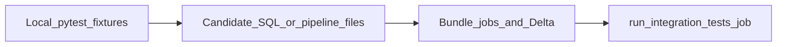

# Development loop and feedback

This document describes **where feedback comes from** when working in this bundle: local tests against checked-in fixtures, optional filtering of implementations, workspace jobs that materialize data and run cross-checks, and knobs that change iteration speed. Interview scenario, scoring, and deliverables are in your candidate prompt, not this file.

## Local feedback (no Databricks required)

The test suite under `dsa_interview_packet/tests/` runs against small Parquet fixtures (`tests/fixtures/data/`, SF≈0.01). Expected outputs for the analytical queries live under `tests/fixtures/expected/`. From this packet directory, run `make setup` once and then `make test`; see [README.md — Testing](README.md#testing).

PySpark loads the same table names the SQL and pipeline implementations use. **Legacy** pandas implementations are always present; correctness and smoke tests for legacy can run without any candidate-authored Lakehouse or Lakeflow files.

**Lakehouse SQL** and **Lakeflow-style Python functions** are gated by file presence. Until `src/dsa_interview_packet/queries/lakehouse/*.sql` exists, Lakehouse tests are skipped. Until `src/dsa_interview_packet/pipelines/` contains the expected module (see [README.md](README.md)), pipeline tests are skipped. Adding files narrows what is skipped and increases how much of the suite exercises candidate code.

The harness accepts `--impl lakehouse`, `--impl lakeflow`, or `--impl all` (default) so a run can focus on one implementation family’s tests. That affects which test modules participate in a given invocation; it does not change fixture data.

Together, this yields a **tight loop**: edit implementation → run a single test node or a file-scoped subset → expand to the full `make test` run as needed. Exact command lines are in [README.md — Testing](README.md#testing); [FAQ.md](FAQ.md) covers common candidate questions without duplicating those commands.

## Workspace feedback (Databricks)

Deploying the bundle and running jobs uses the Databricks CLI (`databricks bundle deploy`, `databricks bundle run`). Default initialization **materializes** source tables, simulated system tables, and ML training/evaluation in the target catalog/schema; see **What’s Deployed** and **Deployment** in [README.md](README.md).

The **`run_integration_tests`** job executes `run_integration_tests.py` as a serverless job. It compares implementations against **live** seeded data (not the tiny local fixtures) and performs parity and property checks across whatever implementations exist. That stage is **slower** and depends on prior seed/simulate/ML steps when the workspace is cold.

`run_lakehouse_queries.py` executes your Lakehouse SQL files in the workspace and writes each result to a `lakehouse_*` Delta table, for validating SQL outside the local harness. The bundle does not define a job for it: after `make deploy`, run it as a Python script task in a job you create, passing `--catalog`, `--schema`, and `--queries-path` (the synced `queries/lakehouse` folder under `/Workspace/Users/<your-email>/.bundle/dsa_interview_packet/dev/files/`). `make integration` also runs your SQL against live data as part of its parity checks.

## Faster iteration mechanics

The bundle defines a **`dev_fast`** target in `databricks.yml` that overrides sampling-related variables so seeds and ML samples stay smaller. The **`_dsa_interview_bundle_state`** table in the target schema records fingerprints so optional bundle variables can skip re-seeding or re-simulation when populated data matches a version string; see README **Skip re-seed / re-simulate**.

Commented examples for selective bundle runs, `dev_fast`, and skip flags live in `src/dsa_interview_packet/scripts/e2e_selective.sh`. The **Fast iteration and E2E** table in [README.md](README.md) maps change types (migration-only, app-only, ML-only, full cold start) to typical command patterns.

## Flow overview

Local runs validate against **frozen fixtures**; integration validates against **workspace data** after jobs have populated the schema.
